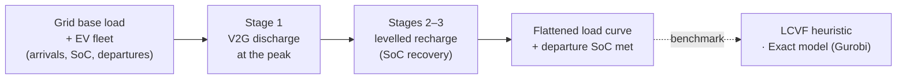
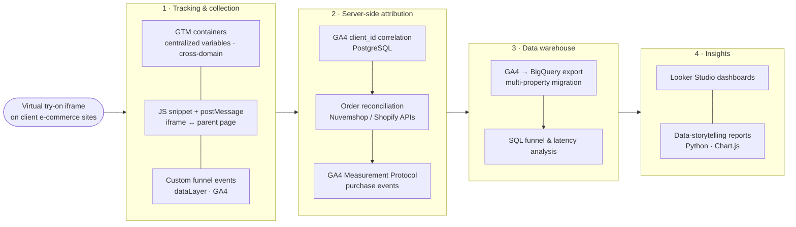

**PhD candidate in Computer Science** · Researcher at LSCAD · Data engineer at MTR · Brazil 🇧🇷

I work on **smart charging of electric vehicles**: scheduling algorithms that flatten grid load (valley-filling, peak-shaving, Vehicle-to-Grid) and multi-objective optimization with evolutionary algorithms (NSGA-II / NSGA-III). In industry, I build analytics and data pipelines (GA4 → BigQuery, server-side tracking with GTM and the Measurement Protocol).

### 🔬 Research

- **V2G scheduling for city-scale EV fleets** – a three-stage peak-shaving algorithm with state-of-charge recovery, compared against a charging-only heuristic (LCVF) and an exact Gurobi model on 768 instances.
  Reproduction package: [`v2g-3-stages`](https://github.com/guigloriano/v2g-3-stages) *(manuscript under review)*
- **Smart decision making in EV charging systems** – scenarios and algorithms for charging station operation.
  [`Article-Smart_Decision_Making_in_EVCS`](https://github.com/guigloriano/Article-Smart_Decision_Making_in_EVCS)
- **Topics:** valley-filling · V2G · combinatorial optimization · NSGA-III · reproducible research

### 💼 Industry · MTR

Analytics and data engineering for a virtual try-on (VTO) product embedded in e-commerce sites — from event tracking inside the iframe to server-side purchase attribution and reporting.

### 🛠️ Stack

**Analytics & data engineering** 

**Scientific computing** 

<!-- TODO: uncomment and fill in your links
### 📫 Contact

[LinkedIn](https://www.linkedin.com/in/...) · [Lattes](http://lattes.cnpq.br/...) · [ORCID](https://orcid.org/...) · [Google Scholar](https://scholar.google.com/citations?user=...)
-->

### 🐍 Contributions

<picture>
  <source media="(prefers-color-scheme: dark)" srcset="https://raw.githubusercontent.com/guigloriano/guigloriano/output/github-snake-dark.svg" />
  <source media="(prefers-color-scheme: light)" srcset="https://raw.githubusercontent.com/guigloriano/guigloriano/output/github-snake.svg" />
  
</picture>

---

🇧🇷 Em português

Doutorando em Ciência da Computação e pesquisador no LSCAD. Pesquiso **recarga inteligente de veículos elétricos** — algoritmos de escalonamento que achatam a curva de carga da rede (*valley-filling*, *peak-shaving*, V2G) e otimização multiobjetivo com algoritmos evolutivos (NSGA-II/NSGA-III). Na indústria, atuo com engenharia de dados e analytics na MTR (pipelines GA4 → BigQuery, rastreamento server-side com GTM e Measurement Protocol).

